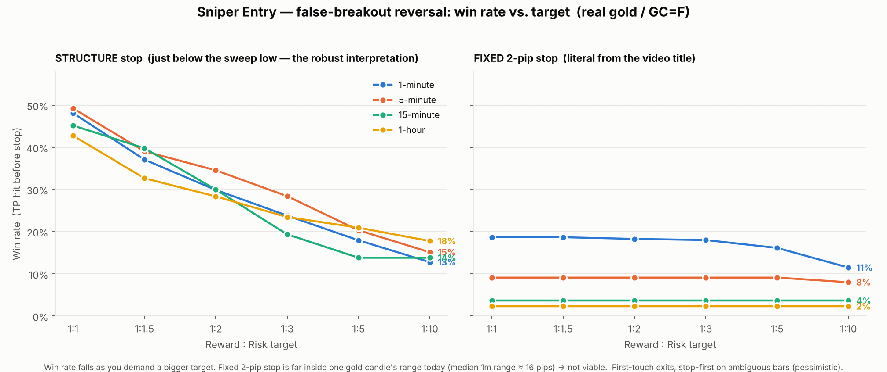

# Sniper Entry — Backtest & Win Rate

Honest historical test of the false-breakout reversal strategy
(`MQL5/Indicators/SniperEntry_FalseBreakout.mq5`) on **real gold price data**.

> **TL;DR — there is no single "win rate."** It depends entirely on how big a target
> you take. With the robust (structure) stop on gold: **~45–49% at 1:1**, **~30–35% at
> 1:2**, **~24–28% at 1:3**, **~18–21% at 1:5**, **~13–18% at 1:10**. The *literal*
> fixed **2-pip** stop from the video title is **not viable at today's gold
> volatility** (win rate ~2–19%, negative expectancy). Across the whole test the
> strategy is **roughly break-even**, not a proven edge.

---

## Data & method

- **Instrument:** `GC=F` (COMEX gold futures — a close proxy for XAUUSD spot; **not**
  your broker's exact feed).
- **Samples:** 1-minute ≈ 27,400 bars (~28 days), 5-minute ≈ 13,600 bars (~60 days),
  15-minute ≈ 4,560 bars (~60 days), 1-hour ≈ 13,700 bars (~2 years). Data pulled Oct 2026.
- **Signals:** the *exact* non-repainting detection from the indicator (A-B-C-D +
  false breakout + reclaim), both long and short.
- **Entry:** reclaim close of the signal bar. **Exits scanned from the next bar** (no look-ahead).
- **Exit model:** first-touch of stop or target; if a bar's range covers **both**, it
  is counted as the **stop** (pessimistic — OHLC bars, not ticks).
- **One position at a time**; a new signal while in a trade is skipped.
- **Pip:** gold 1 pip = 0.10 (so 2 pips = 0.20, matching the video's 1819.83 → 1819.63).
- **Win rate** is reported cost-free (TP before stop). **Expectancy** is also shown
  with a flat **2-pip spread** charged per trade.

Two stop models are tested:
1. **Fixed 2-pip** — literally `entry − 0.20`, as the title says.
2. **Structure** — just below the sweep low **D** (the robust reading of "risk sits
   under the liquidity grab"; this is how the 2-pip stop *worked* in 2022 when gold
   was ~$1,820 with sub-dollar candles).

---

## Headline win rate (both directions combined)

### Structure stop (the viable interpretation)

| Timeframe | Signals | 1:1 | 1:2 | 1:3 | 1:5 | 1:10 | Avg risk |
|---|--:|--:|--:|--:|--:|--:|--:|
| **1-minute**  | ~530–700 | **48.1%** | 29.9% | 23.8% | 18.0% | 12.8% | ~30 pips |
| **5-minute**  | ~270–335 | **49.3%** | 34.6% | 28.4% | 20.4% | 15.1% | ~66 pips |
| **15-minute** | ~95–105  | **45.2%** | 30.0% | 19.4% | 13.8% | 13.8% | ~130 pips |
| **1-hour**    | ~326–374 | **42.8%** | 28.4% | 23.5% | 21.0% | 17.8% | ~225 pips |

### Fixed 2-pip stop (literal) — not viable today

| Timeframe | 1:1 | 1:2 | 1:3 | 1:5 | 1:10 |
|---|--:|--:|--:|--:|--:|
| 1-minute  | 18.7% | 18.3% | 18.0% | 16.2% | 11.5% |
| 5-minute  | 9.1%  | 9.1%  | 9.1%  | 9.1%  | 8.0%  |
| 15-minute | 3.6%  | 3.6%  | 3.6%  | 3.6%  | 3.6%  |
| 1-hour    | 2.3%  | 2.3%  | 2.3%  | 2.3%  | 2.3%  |

---

## Expectancy (is it actually profitable?)

Win rate alone doesn't pay — expectancy does. Per-trade expectancy, in pips,
**with a 2-pip spread** charged (negative = losing):

| | 1:1 | 1:2 | 1:3 | 1:5 | 1:10 |
|---|--:|--:|--:|--:|--:|
| 1-min (structure) | −2.8 | −6.4 | −4.7 | −3.0 | −4.3 |
| 5-min (structure) | −4.9 | **−0.3** | **+5.9** | −0.4 | −6.5 |
| 1-hour (structure)| −39 | −36 | −20 | **+2.1** | **+1.8** |
| 1-min (fixed 2-pip)| −3.3 | −2.9 | −2.6 | −2.1 | −1.5 |

- Most cells are **negative** after spread. A few edge **positive** (5-min at ~1:2–1:3,
  1-hour at ~1:5–1:10, profit factor ≈ 1.0–1.2) — but on **small samples**, so treat
  them as noise, not a discovered edge.
- Profit factor sits around **0.8–1.2** almost everywhere ≈ **break-even**.

---

## Why the literal 2-pip stop fails now

In the Jan-2022 video, gold was **~$1,820** and 1-minute candles were tiny
(~$0.20–0.40), so a **$0.20 (2-pip)** stop sat just under the sweep low and could
survive. In 2026 gold is **~$4,100–4,440** and the **median 1-minute candle range is
~$1.60 (16 pips)** — a 0.20 stop is *inside* a single candle, so it's stopped out by
ordinary noise (and intrabar you can't even tell whether stop or target hit first).
That is why the fixed-2-pip column is flat and low, and why the **structure stop's
real risk is ~30 pips on 1-minute gold, not 2**.

**The takeaway:** the method's logic (buy the reclaim of a swept support, risk just
under the sweep) is sound and timeframe-portable; the literal "**2 pips**" is an
artifact of 2022 gold's volatility, not a constant. Size the stop to the sweep, not to
a fixed pip count.

---

## Honest caveats

- Futures proxy, not your broker's XAUUSD feed; **spread/slippage/commission vary** and
  the strategy is extremely spread-sensitive at tight stops.
- OHLC first-touch with **stop-first on ambiguous bars** — a pessimistic rule chosen
  deliberately; a tick-level test (or MT5's "Every tick based on real ticks") would
  differ, usually by a few %.
- The video "rides" winners with no fixed TP; here that is approximated by the R:R
  columns (win rate at 1:X = how often price reached +XR before the stop).
- Samples are weeks-to-months of one 2026 regime; **a different period gives different
  numbers**. One profitable video example is not a statistical edge.
- **The authoritative test is MT5's Strategy Tester on *your* broker's M1 XAUUSD data
  with your real spread.** This indicator is non-repainting, so those results should
  line up with these.

*Reproduce:* `tools/fetch_data.py` → `tools/backtest.py` (prints every table) →
`tools/make_chart.py` (the figure). Detection logic: `tools/sniper_strategy.py`
(identical to the indicator's `DetectBuy`/`DetectSell`).
